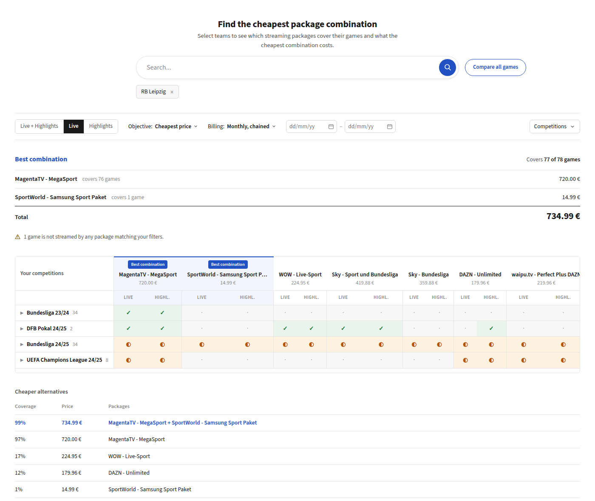

# Best Combination: Streaming Package Comparison

Find the cheapest combination of streaming packages that covers the football
games of the teams you care about.



**[Watch a short demo of the app](https://www.youtube.com/watch?v=kCM-nfbpoCc)**

Users pick one or more teams. The app ranks all streaming packages by coverage
and computes the **cost-optimal combination** of packages covering as many of
the selected games as possible. Formally this is **weighted set cover**, which
is NP-hard in general but exactly solvable here because the instance is tiny
(~40 packages).

## How to run locally

Docker is the only prerequisite. No Python, no Node, no environment variables,
no manual import step.

```bash
git clone git@github.com:EliasDevv/stipendium-solution.git
cd best-combination-solution
docker compose up
```

Then open **http://localhost:8080**.

That is the entire setup. The first `up` builds two images and takes a few
minutes, later starts take seconds. The backend container migrates, collects
static files, and seeds the catalog **once**, so a fresh clone comes up
working. Restarts keep the existing data.

nginx serves the built Angular app and proxies `/api` and `/admin` to Django,
so the whole app lives under one origin and one port (no CORS, no dev-server
proxy). The API is additionally published on `http://localhost:8000` for
`curl`:

```bash
curl -s -X POST localhost:8000/api/compare \
  -H 'Content-Type: application/json' -d '{"teams":["RB Leipzig"]}'

docker compose down      # stop. Add -v to also drop the database volume.
```

This stack deliberately runs the **production** settings
(`config.settings.prod`), so it exercises the Redis cache backend and the
strict security defaults rather than just the permissive dev module. Only the
HTTPS redirect is switched off, because nginx speaks plain HTTP locally.

### Running against the real challenge dataset

Out of the box the app seeds itself with a deterministic synthetic dataset
(5000 games, 40 packages) of the same shape as the real one, so it works
without any data on hand. To use the real CSVs instead, copy them into `data/`
**before the first** `docker compose up`:

```bash
cp ../best-combination-coding-challenge-dataset/*.csv data/
docker compose up
```

```
data/
├── bc_game.csv
├── bc_streaming_offer.csv
└── bc_streaming_package.csv
```

The container mounts `data/` and imports whatever CSVs it finds there, falling
back to the synthetic dataset when the directory is empty. If the stack has
already seeded itself, wipe it first with `docker compose down -v`, because
seeding only happens against an empty catalog.

The files come from the private challenge repo
[`TechUp-Stipendium/best-combination-coding-challenge-dataset`](https://github.com/TechUp-Stipendium/best-combination-coding-challenge-dataset)
and are deliberately not committed here, so `data/` is gitignored. Only the
benchmark numbers further below are specific to the real dataset (8,871 games,
36 packages).

### Running it natively (for development)

Prerequisites: Python 3.12 and Node 20+. Settings are read from environment
variables only (there is no `.env` loader), and `.env.example` documents every
variable the backend understands.

```bash
python3.12 -m venv backend/.venv && source backend/.venv/bin/activate
cd backend && pip install -e . --group dev
python manage.py migrate
python manage.py generate_synthetic_dataset   # or import_dataset for the real CSVs
python manage.py runserver                    # API on http://localhost:8000
```

With no `POSTGRES_HOST` set, the backend falls back to a local SQLite file and
caches in-process, so this path needs no external services at all, not even
Docker. That is also what makes `pytest` runnable straight after a clone. To
develop against PostgreSQL and Redis instead, start those two containers and
point the backend at them before running `migrate`:

```bash
docker compose up db redis -d
export POSTGRES_HOST=localhost POSTGRES_PASSWORD=best_combination
```

In a second terminal, start the Angular dev server:

```bash
cd frontend
npm install
npm start        # UI on http://localhost:4200, /api proxied to :8000
```

`import_dataset` looks in `<repo>/data` by default and accepts `--path`, so a
dataset checkout somewhere else works too:

```bash
python manage.py import_dataset --path /somewhere/else
```

## Features

- **Team search** (debounced autocomplete) with multi-team selection, plus a
  "compare all games" mode for the *fewest-services-for-everything* query.
- **Forgiving team names**: input is folded to a canonical key, with
  diacritics stripped ("munchen" finds "München") and corporate noise tokens
  dropped ("FC Bayern" = "Bayern"). Autocomplete ranks whole-name prefix
  before word prefix before substring, so "st" surfaces "FC St. Pauli". Names
  that survive the request without matching anything are named back in
  `unknown_teams` instead of silently returning nothing. The importer warns
  when the folding would merge two plausibly different clubs into one mask.
- **Coverage matrix**: games × packages with Live/Highlights column pairs and
  tournament rollup rows (full / partial / none) expandable into single games.
  Best-combination packages are ranked first and highlighted.
- **Exact best combination** (provably cheapest, not a heuristic) plus a
  **Pareto front** of cheaper partial-coverage alternatives when no
  combination covers everything. If the solver's time budget ever expires,
  the response says so (`best_combination.exact: false`) instead of silently
  presenting the best-found result as optimal.
- **Redundancy pass**: before a combination is shown it is stripped of
  packages that add neither coverage nor savings once the result is
  re-priced. On the 4-team reference query this alone takes the answer from
  seven services to four at the same price.
- **Filters**: live / highlights / both, cheapest-price vs. fewest-services
  objective, monthly-chained vs. yearly billing, date range, tournaments.
- **Shareable searches**: the URL is the source of truth for every parameter.
  Searches are also auto-saved server-side (`GET /api/searches`).

## Architecture

**Cold start** (once per process):

```
CSV files (data/) ──import_dataset──> PostgreSQL/SQLite ──build_index──> BitIndex (in RAM)
```

When the index is built, every streaming package is compiled into a bitmask
over all games
(Python's arbitrary-precision `int`): bit *i* set ⇔ the package streams the
game at position *i*. Team, tournament, and month masks are precomputed the
same way. Bits are `(starts_at, id)`-sorted, so a date range is a contiguous
bit range found by bisection.

**Hot path** (per request):

```
POST /api/compare ──> cache (SHA-256 of normalized body) ──miss──> solver ──> BitIndex
```

A query is resolved to a target bitmask (union of the selected teams' masks,
clipped by date range and tournament filter). The solver then works purely on
integers, with **no database access on the request path**. Since the dataset is
static, responses are pure functions of the request and cached indefinitely
(LocMem in dev, Redis in prod).

**Why the solver is decoupled from Django:** `backend/solver/` imports no
Django code and touches no database. It consumes only its own frozen
dataclasses. This keeps the algorithmic core unit-testable in microseconds
(no fixtures, no ORM), benchmarkable in isolation, and portable. Django is
just the delivery mechanism around it. The single bridge is
`catalog/selectors.py`, which reads the ORM once at startup and feeds plain
data into `build_index`.

## Algorithm

Weighted set cover over bitmasks, solved **exactly**
(`backend/solver/setcover.py`):

1. **Reduction.** Intersect every package mask with the target mask, then drop
   packages that contribute nothing or have no bookable price.
2. **Dominance pruning.** Drop any package whose (games, cost) is dominated
   by a cheaper-or-equal superset.
3. **Greedy upper bound.** Best cost-per-new-game ratio first, compared with
   integer cross-multiplication rather than floats. This classic
   ln(n)-approximation becomes the incumbent.
4. **Branch & bound.** Branch on the *rarest* uncovered game (the one fewest
   packages cover), then prune with the incumbent, an admissible lower bound
   (best weight-per-game ratio × uncovered count), and a memo on the
   uncovered mask. The result is the exact optimum. A 50 ms safety valve
   returns the best solution found if a pathological instance ever exceeds it.
5. **Redundancy pass** (`backend/solver/reprice.py`). The winning set is then
   re-priced (see *Pricing model*) and trimmed: repeatedly drop the package
   that changes neither the covered games nor the re-priced total, most
   expensive first. The search cannot do this itself, because a package that
   looks redundant by coverage can still absorb a month and make the
   combination re-price cheaper. Only the re-priced cost decides.

Exact optimization is feasible because there are only **~40 packages**: after
reduction and dominance pruning the branching factor is small, and every set
operation is a single big-int AND/OR/popcount over all games at once.

Notable modeling choices:

- **`requirement="both"`** runs in a doubled bit space (low half = live, high
  half = highlights), so live and highlights may come from *different*
  packages. A game counts as covered only when both halves are. Games that
  cannot get both halves from anyone are excluded from the search target (no
  useless purchases) but still count against the reported coverage.
- **`objective="min_packages"`** is a weight transformation (`BIG + cost`
  with `BIG` above the sum of all costs): one search code path minimizes
  package count first with total price as the tie-break.
- Games streamed by nobody never block the search: the solver covers the
  coverable subset optimally and reports honest partial coverage.

If full coverage is impossible, the API additionally returns a **Pareto
front**: for each achievable coverage level, the minimal price
(`backend/solver/pareto.py`, built from the exact optimum, greedy-trajectory
prefixes, and single packages, dominance-filtered into a monotone curve).

## Pricing model

- Prices are integer cents. **`NULL` price = not bookable at that interval**
  (a free package has an explicit `0`).
- `yearly`: one yearly subscription = `12 × monthly_price_yearly_subscription`.
- `monthly_chained`: pay only the months that contain covered games, capped
  by the yearly price: `min(months_needed × monthly, 12 × yearly_monthly)`.
  Yearly-only packages fall back to the yearly price.
- `flexible`: cheaper of the two (numerically equal to `monthly_chained`
  because of the cap, but kept as a distinct API value).
- A package's `months_needed` counts the distinct months of **its own
  clipped coverage** (the requested games it can serve). A package needed
  only in August costs one month, regardless of the query's full span. This
  keeps costs constant per (package, query), so the problem stays a plain
  additive set cover and the optimum is exact w.r.t. this model.

## Testing & benchmarks

```bash
cd backend
pytest                    # 601 tests: solver units, brute-force cross-check, API contract
ruff check . && ruff format --check .
mypy solver/              # solver is strictly typed (disallow_untyped_defs)
python manage.py benchmark
python manage.py verify_independent   # slow, optional: independent ILP cross-check

cd ../frontend
npx ng test --watch=false --browsers=ChromeHeadless   # karma/jasmine component tests
```

CI runs ruff, mypy, pytest and the frontend tests on every push.

The highest-value test is a **brute-force cross-check**: on 100 seeded random
instances (≤ 12 games, ≤ 8 packages) the branch & bound result is compared
against exhaustive enumeration of all package subsets, for both objectives.

`manage.py verify_independent` additionally cross-checks the **real dataset**
end to end: a deliberately pipeline-free reimplementation (pandas straight on
the CSVs, README pricing model, exact set cover via a CBC ILP) recomputes the
four benchmark queries for requirement live and both, and the command diffs
target games, coverable games, per-package costs, and the optimum against the
production pipeline stage by stage.

Reference queries from the challenge, measured with `manage.py benchmark` on
the **real dataset** (8,871 games, 36 packages). "Solver" is one full
pipeline pass (reduction + exact solve + Pareto front). "Endpoint" is the
complete uncached `POST /api/compare` view path through Django's test client
(validation, solve, payload build, JSON rendering, saved-search write) over
20 runs with the cache cleared before each:

| Query | Solver (median) | Endpoint p50 | Endpoint p95 | Payload | Result |
|---|---|---|---|---|---|
| RB Leipzig (all games) | 0.4 ms | 2.1 ms | 2.6 ms | 15 KiB | 2 packages, 734.99 € |
| Hatayspor + Deutschland + RB Leipzig + Real Madrid | 2.8 ms | 5.8 ms | 6.9 ms | 35 KiB | 4 packages, 872.01 € |
| All teams, fewest services | 30.7 ms | 82.9 ms | 128.6 ms | 1,327 KiB | 7 packages, 1269.76 € |
| Oxford United + Los Angeles FC + AS Rom | 0.5 ms | 2.2 ms | 3.7 ms | 18 KiB | 3 packages, 324.79 € |

All four run with the request defaults `requirement=live` and
`billing=monthly_chained`. Only `teams` and `objective` vary per row (query 3
is the *fewest services* one, `objective=min_packages`). The numbers are one
run of `manage.py benchmark`. The three team-scoped rows repeat within a few
tenths of a millisecond. The all-teams row is dominated by building and
rendering 1.3 MiB of JSON and swings with machine load (p95 ranged from 118 to
131 ms over eight runs here), so read it as "well over the budget", not as
128.6.

(The 4-team and all-teams prices dropped versus the static model, from
928.96 € to 872.01 € and from 1336.69 € to 1269.76 €. That is the post-hoc
re-pricing at work, and the 4-team result also shrank from seven packages to
four at that same price, which is the redundancy pass. See *Design
decisions*.)

Every team-scoped query sits comfortably inside the p95 < 100 ms budget, and
cached repeats are sub-millisecond. The one exception is the degenerate
"all 8,871 games" query: the solver itself needs only ~31 ms, but the
response enumerates every game and every package's per-game indices
(~1.3 MiB of JSON), and building, rendering, and caching that payload pushes
the p95 past the budget. This is a known trade-off, accepted deliberately: the
full matrix is what the comparison UI renders, the response is cached after
the first hit, and "cover literally every game in the dataset" is a stress
case rather than a user story. Aggregating the game list for that mode would
restore the budget at the cost of a second response shape.

## Project structure

```
├── backend/
│   ├── config/           # Django project: split settings (base/dev/prod), urls, asgi/wsgi
│   ├── catalog/          # Data layer: models, CSV import, selectors (ORM→solver bridge),
│   │   │                 # services (writes), team-name normalization
│   │   └── management/commands/   # import_dataset, generate_synthetic_dataset,
│   │                              # benchmark, verify_independent (ILP cross-check)
│   ├── solver/           # Pure-Python set-cover core (NO Django imports):
│   │   │                 # types (frozen dataclasses), index (BitIndex), pricing,
│   │   │                 # setcover (exact B&B), pareto, reprice (post-hoc pricing
│   │   │                 # + redundancy pass), compare (facade used by the API)
│   ├── api/              # Thin DRF layer: serializers, views, urls, response caching
│   ├── tests/            # pytest suite (one test module per solver module + API contract)
│   ├── Dockerfile        # gunicorn image used by the quickstart stack
│   └── docker-entrypoint.sh   # migrate + collectstatic + one-time seeding
├── frontend/             # Angular 19 standalone app (signals, no NgRx, no UI framework)
│   ├── Dockerfile        # two-stage: npm build → nginx
│   ├── nginx.conf        # serves the SPA, proxies /api + /admin, gzips JSON
│   └── src/app/
│       ├── core/         # api.service, models (API types), signal-based comparison store
│       └── features/     # team-search (debounced autocomplete),
│                         # comparison (page, coverage matrix, competitions dropdown,
│                         # day-first date field), searches (recent-searches panel)
├── data/                 # Challenge CSVs go here (gitignored, see *How to run locally*)
├── docs/                 # Screenshots used by this README
├── .github/workflows/    # CI: backend gates (ruff, mypy, pytest) + frontend build/test
├── docker-compose.yml    # The full stack: PostgreSQL 16, Redis 7, backend, nginx
└── README.md
```

## Design decisions & trade-offs

- **Bitmasks over SQL joins.** The dataset is small and static, so compiling
  it into ~40 big-int masks makes every query a handful of integer ops.
  Trade-off: the index must be rebuilt on data change (acceptable, because
  data never changes at runtime) and lives per-process (fine for a
  single-node deployment).
- **Index built lazily, exactly once per process.** The `BitIndex` is compiled
  on the first compare request behind a lock, not in `AppConfig.ready()`.
  `ready()` runs for every management command, including `migrate` against a
  schema that may not exist yet, and Django warns about database access
  during app initialization. Every later request reuses the warm singleton.
- **Exact solver over heuristics.** With ~40 packages, branch & bound with
  greedy bounds finds the *provably* cheapest combination, a correctness
  claim a greedy-only solution cannot make. Greedy is still computed first as
  the search bound, so the worst case degrades gracefully: a time-capped
  "best found" flagged as `exact: false` in the response instead of a timeout.
- **Solver as a pure package.** Slightly more plumbing (selectors bridge,
  duplicated dataclasses instead of model instances) in exchange for
  microsecond unit tests, honest benchmarks, and zero risk of accidental ORM
  calls on the hot path. The rule is absolute: `backend/solver/` imports no
  `django.*`, no models, no settings, and never touches the database. It
  consumes only its own frozen dataclasses and the in-RAM `BitIndex`.
- **Layered request path.** Views validate, check the cache, delegate, and
  serialize, and they hold no business logic. Database reads go through
  `catalog/selectors.py` (the single ORM→solver bridge), writes through
  `catalog/services.py`, and computation through `solver/`. Game and package
  ids come from the CSVs and are never autogenerated, so a re-import does not
  renumber them.
- **A measured performance budget.** The target is p95 < 100 ms server-side
  for an uncached `POST /api/compare`. `manage.py benchmark` measures the four
  reference queries, and every solver change is checked against it before
  merging, so a regression surfaces as a number instead of a feeling. The one
  deliberately accepted exception is the degenerate all-games query described
  under *Testing & benchmarks*.
- **Static search costs, re-priced results.** During the *search* a package
  is priced by the months of its own potential coverage, which keeps the
  objective additive and branch & bound exact. Every *displayed* combination
  (best combination and each Pareto point) is then post-hoc **re-priced**:
  covered needs (game × live/highlights) are assigned to the chosen packages,
  forced unique assignments first, then an exact minimal sub-cover per month
  using marginal month costs. Each package therefore pays only the months it
  is actually needed, and any package the re-pricing renders pointless is
  dropped from the answer. The displayed total is never above the static one.
  Honest caveat: the search optimizes static costs, so in principle a
  rejected combination could re-price even cheaper. The Pareto candidate
  pools partially close that gap (if a pool re-prices cheaper at equal
  coverage, it *becomes* the best combination). The fully
  subscription-scheduling-aware search would be a set cover over
  (package × month) pairs for marginal gain.
- **Index-based API payload.** `live_idx`/`highlight_idx` reference positions
  in the `games` array instead of repeating game objects per package, keeping
  the games×packages matrix response compact.
- **Response caching by content hash.** Requests are normalized (teams
  sorted, defaults filled) before hashing, so semantically equal queries share
  one cache entry. Normalization and key derivation sit next to each other in
  `api/views.py` and have to change together: a key that ignored a newly added
  parameter would serve one query's answer for a different query. This is safe
  only because the dataset is immutable, so it needs revisiting if live data
  updates ever land (currently out of scope).
- **URL as frontend state.** Every search parameter lives in query params:
  shareable links, working back button, and a store that only mirrors the
  URL instead of owning state.
- **SQLite fallback.** PostgreSQL is the target, but the app runs and tests
  with zero external services, so reviewers can `pytest` without Docker.
- **Two run paths, on purpose.** `docker compose up` is the review path: one
  command, one port, no toolchain, and the seeding decision (real CSVs vs.
  synthetic) made automatically, so nothing depends on the reviewer having
  exactly Python 3.12 and Node 20. The native venv/`ng serve` path stays the
  development path, with autoreload, HMR, and a `pytest` run that needs no
  containers at all. Neither is a wrapper around the other. The container just
  runs the same management commands a developer would type.
